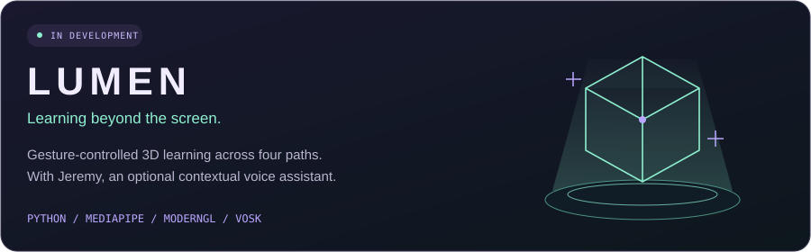
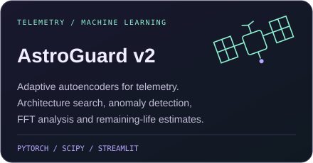
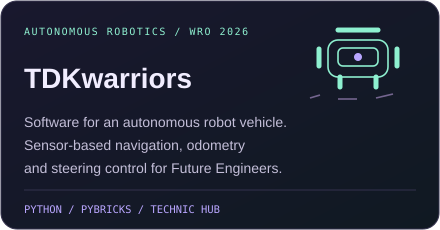
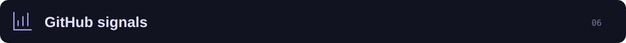
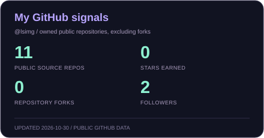
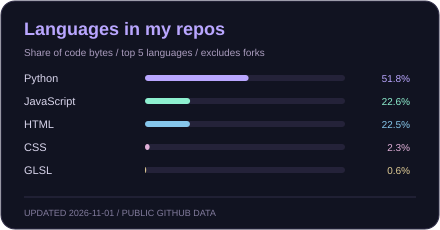

<!-- Profile content reviewed against lsimg's public repository READMEs and source files. -->

  
    
  <a href="#about-me">about</a> &nbsp; · &nbsp;
  <a href="#featured-projects">featured</a> &nbsp; · &nbsp;
  <a href="#project-constellation">projects</a> &nbsp; · &nbsp;
  <a href="#tech-stack">toolbox</a> &nbsp; · &nbsp;
  <a href="#github-signals">activity</a>
    
  <samp>curiosity → experiments → things you can interact with</samp>

 

I'm **Gulsim**, a student developer at **NIS Taldykorgan**. I build gesture-controlled interfaces, educational 3D tools, machine learning experiments, and web prototypes.

My projects explore how machines **see**, how software **responds to people**, and how data can support practical decisions — from satellite telemetry to agriculture in Kazakhstan.

I'm also the **head of software engineering for Team TDKwarriors**, working on an autonomous vehicle for **WRO Future Engineers 2026**.

  
  &nbsp;
  

 

**[Lumen](https://github.com/lsimg/Lumen)** brings four learning paths into one interactive 3D application: **robotics**, **computer components**, **human anatomy**, and **interactive learning for children**.

- **Explore with your hands:** point at parts, pinch to select, move with an open palm, rotate with a V gesture, and scale with two hands.
- **Learn by interacting:** inspect component descriptions, manipulate robot joints, and play fruit-matching and size-matching activities.
- **Ask Jeremy:** an optional voice assistant uses the current model, selected part, and application state as context. Wake-word detection, speech recognition, and speech synthesis run locally; generated answers use OpenRouter.

<samp>Python · OpenCV · MediaPipe · ModernGL · Trimesh · Vosk · PyTorch/Silero</samp>

  

  
  

**[AstroGuard v2](https://github.com/lsimg/Astroguard.v2)** — a telemetry research application with a PyTorch autoencoder, automated architecture search, FFT analysis, and remaining useful life estimation. Its loader supports NASA IMS, SMAP/MSL, CSV, and NumPy data, with a Streamlit monitoring interface.

**[TDKwarriors](https://github.com/lsimg/TDKwarriors)** — a team robotics project for WRO Future Engineers 2026. My role focuses on software: Pybricks control, sensor-based navigation, odometry, and steering. The repository also documents the OpenMV–Arduino–Technic Hub architecture and the vehicle's mechanical evolution.

 

<samp>more experiments from my public repositories</samp>

### Vision & gesture interfaces

| Project | What it does | Built with |
| :--- | :--- | :--- |
| **[Mediapipe_Draw](https://github.com/lsimg/Mediapipe_Draw)** | An air-drawing app: draw with an index finger, choose colors with two fingers, erase with a fist, and save drawings as PNG. Includes asynchronous tracking and adaptive smoothing. | Python · OpenCV · MediaPipe · NumPy |
| **[Mouse_Move](https://github.com/lsimg/Mouse_Move)** | A webcam-controlled virtual mouse for Windows. Hand gestures move the pointer, click, double-click, scroll, and pause control, with cursor smoothing and gesture debouncing. | Python · MediaPipe · OpenCV · PyAutoGUI |
| **[two-hand-image-zoom](https://github.com/lsimg/two-hand-image-zoom)** | Resize an image by moving two raised index fingers apart or together. Includes smooth scaling, scale limits, and transparent PNG support. | Python · OpenCV · MediaPipe |

### Data & applied AI

| Project | What it does | Built with |
| :--- | :--- | :--- |
| **[AstroGuard](https://github.com/lsimg/AstroGuard)** | The earlier vibration-monitoring prototype: MLP-based anomaly scoring, FFT plots, health trends, and a Streamlit dashboard. Includes a Dockerfile. | Python · scikit-learn · SciPy · Streamlit · Docker |
| **[AyaraiBI](https://github.com/lsimg/AyaraiBI)** | An agricultural risk assistant for Kazakhstan. Combines Open-Meteo forecasts and NASA POWER climate data with rule-based risk scoring and optional AI explanations for field decisions. | Python · FastAPI · Pydantic · HTTPX · Groq/Gemini APIs |

### Web prototypes for people

| Project | What it does | Built with |
| :--- | :--- | :--- |
| **[BalaQoldau](https://github.com/lsimg/Bala-Qolda)** | A bilingual family-and-specialist support prototype: specialist discovery, child profiles, development plans, home activities, and Russian/Kazakh AAC communication cards. Includes a Groq-powered AI module with plan review and approval states. | HTML · CSS · JavaScript · Groq API · SQL/D1 |
| **[SanaTynys](https://github.com/lsimg/SANA-TYNYS)** | A browser-based prototype for tracking nicotine habits: onboarding, a progress dashboard, a journal, a calendar, short exercises, and Sana Coach. Data is stored locally; the two interface variants connect to Groq or Gemini. | HTML · CSS · JavaScript · localStorage · AI APIs |

 

| Focus | Where I'm exploring it |
| :--- | :--- |
| **Computer Vision & HCI** | Hand tracking, gesture recognition, and interaction in Lumen and my webcam experiments. |
| **Interactive education** | Exploring 3D models, robotics, anatomy, and learning through play in Lumen. |
| **Machine Learning & signals** | Telemetry anomaly detection, autoencoders, and spectral analysis in AstroGuard. |
| **Autonomous robotics** | Navigation, localization, and motor control with Team TDKwarriors. |
| **Useful AI interfaces** | Agricultural decision support, contextual voice assistance, and human-reviewed AI workflows. |

 

<samp>tools used across my repositories</samp>

  
  
  
  
  
   
  
  
  
  
  
   
  
  
  
  
  
   
  
  
  
  

 

  
  

  
   
  <samp>a little bot, a lot of curiosity.</samp>

  

<!-- GitHub Actions refreshes these visuals daily using public GitHub data. -->

  

